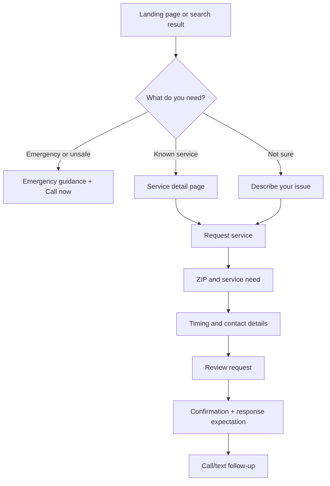

# Website UI Redesign: Northstar Home Services

> A conversion-focused redesign for a local home-services business, turning an outdated, phone-first website into a clear path from urgent need to booked appointment.

## 1. Project snapshot

| Item | Details |
|---|---|
| **Role** | Lead product designer and UX strategist: audit, information architecture, interaction design, visual system, prototyping, and validation plan |
| **Subject** | Northstar Home Services, a plausible local provider of plumbing, electrical, HVAC, and general home-repair services |
| **Scope** | Responsive public marketing and service-booking experience; no authenticated customer portal or technician operations tools |
| **Platform** | Responsive website optimized for mobile, with desktop layouts for high-intent and research-oriented visitors |
| **Timeline** | 3 weeks: discovery and audit (days 1–4), structure and flows (days 5–8), visual design and prototype (days 9–15) |
| **Deliverables** | Current-state audit, sitemap, prioritized user flow, responsive page specifications, design system, high-fidelity prototype plan, testing plan, and developer-ready handoff guidance |
| **Primary conversion** | Request a service appointment or call the 24/7 dispatch line for emergencies |

## 2. Problem, opportunity, and assumptions

### Problem

The existing Northstar website feels like an early-2010s brochure: generic trust messaging, dense service navigation, long paragraphs, and a small phone number with no explanation of what happens next. On mobile, a booking action appears only after excessive scrolling. A homeowner with a burst pipe needs reassurance and a direct next step; someone comparing HVAC plans needs scope, proof, and an easy quote request.

### Opportunity

Reframe the site around customer intent rather than internal service categories. Make three promises visible and credible: **we can help with this problem, we will arrive when we say we will, and you can reach a real local person quickly**. A “describe your issue” path, service-specific proof, upfront expectations, and persistent contact actions should increase qualified requests and reduce avoidable questions about coverage and process.

### Assumptions to validate

- Northstar serves a defined metro area and suburbs; eligibility can be checked by ZIP code.
- Emergency dispatch is available 24/7; routine appointments run during published hours.
- Northstar is licensed and insured, offers a workmanship guarantee, and has real reviews and project photography.
- Most visitors arrive on mobile from search, local listings, or referrals; desktop visitors compare services.
- Scheduling software may not change, so the form requests contact rather than promising instant availability.

## 3. Goals and success metrics

### Product goals

1. Help a visitor identify the relevant service or urgency level within 10 seconds.
2. Make the next action—call, request an appointment, or get a quote—persistent and unambiguous.
3. Build trust before contact with local proof, service expectations, reviews, licensing, and transparent response commitments.
4. Reduce cognitive load by using plain language, scannable page sections, and one primary CTA per screen region.
5. Create a flexible foundation that can support new services and locations without a navigation redesign.

### Success metrics

| Metric | Baseline / target | Measurement approach |
|---|---|---|
| Appointment-request completion | Establish baseline in first 2 weeks; target **+25%** vs. current site | Analytics funnel from CTA click to confirmation |
| Mobile CTA engagement | Establish baseline; target **+20%** click-through on “Request service” and “Call now” | Event tracking by device and entry page |
| Form completion rate | Target **70%+** of started requests | Form-start, field-error, and submit events |
| Time to find a relevant service | Target **under 10 seconds** in moderated tests | Task timing: “find help for a leaking water heater” |
| Trust comprehension | Target **80%+** correctly identify guarantee, service area, and arrival expectation | Five-second and comprehension tests |
| Support-call deflection | Target **15%** fewer calls asking about service area, hours, and basic process | Call tagging after launch |

Targets are directional until analytics and call-center data establish a reliable baseline.

## 4. Target users and jobs-to-be-done

| User | Context and need | Job to be done |
|---|---|---|
| **Urgent homeowner** | Water leak, no heat, or electrical concern; stressed and on mobile | “When something feels unsafe or is damaging my home, help me know whether to call now and connect me to a qualified local person.” |
| **Planned homeowner** | Comparing providers for maintenance, installation, or a non-urgent repair | “When I need reliable work, help me compare scope, proof, and expectations so I can request an appointment with confidence.” |
| **Property manager** | Needs repeatable service, invoices, and predictable scheduling across several homes | “When a unit needs repair, help me describe the issue and understand response, documentation, and billing expectations.” |
| **Returning customer** | Has used Northstar before and wants a fast repeat contact | “When I already trust the provider, let me reach the right team without re-learning the whole site.” |

## 5. Current-state and research observations

This concept uses a heuristic review and local-services benchmark, not claimed field research. These observations are hypotheses to test:

- **Navigation is company-centric.** “Residential,” “commercial,” and broad labels force users to translate their problem into business taxonomy.
- **Urgency is invisible.** Emergency contact looks equivalent to routine inquiry, with no safety guidance or response expectation.
- **Trust is asserted, not demonstrated.** “Experienced” and “friendly” appear without reviews, project context, license details, or a visible guarantee.
- **Content is hard to scan.** Long paragraphs bury scope, service areas, and visit expectations.
- **Forms ask too much too soon.** A full address and detailed message are requested before eligibility or the reason for the data is clear.
- **Mobile conversion is interrupted.** CTAs sit below the fold, tap targets vary, and the phone number is not persistent.
- **Local relevance is weak.** Coverage, arrival windows, and recognizable local proof are missing.

Confirm these hypotheses with analytics, five customer interviews, call-log review, and five usability sessions.

## 6. Design decisions and rationale

1. **Lead with “What do you need help with?”** A problem-led entry point matches homeowner search language and reduces translation effort.
2. **Separate emergency and routine paths.** A high-contrast banner provides direct calling and safety guidance without alarming routine visitors.
3. **Use one primary CTA: “Request service.”** “Call now,” “Get a quote,” and “View services” remain secondary through hierarchy.
4. **Show proof beside claims.** Reviews, badges, guarantee language, projects, and technician credentials appear near decisions.
5. **Use progressive disclosure.** Ask ZIP, need, timing, contact details, and optional photo in a clear sequence, explaining the response.
6. **Write for scanning.** Service pages lead with outcome, covered problems, expectations, pricing guidance, and a sticky action.
7. **Design mobile-first.** Mobile gets fixed bottom actions; desktop adds comparison space and richer proof.

## 7. Information architecture and user flow

### Proposed sitemap

- Home
- Services
  - Plumbing
  - Electrical
  - Heating & cooling
  - General home repair
  - Emergency services
- How it works
- Service areas
- Reviews & projects
- About Northstar
- Request service
- Contact / emergency call

### Primary request flow

The global header retains “Call 24/7” and “Request service.” On mobile, these become a fixed bottom action bar after the first viewport.

## 8. Detailed screen and page/layout breakdown

### Home

1. **Announcement/header:** “Emergency help available 24/7,” wordmark, Services, How it works, Areas, Reviews, plus Call and Request actions.
2. **Hero:** “Home repairs, handled with a clear next step.” Name the metro area and response promise; offer Request service and Call now.
3. **Intent cards:** “I have an emergency,” “I need a repair,” “I’m planning a project,” and “I’m not sure.”
4. **Trust row:** licensed and insured, workmanship guarantee, local technicians, and review rating.
5. **Service grid:** plumbing, electrical, heating/cooling, and general repair with concrete problem examples.
6. **How it works:** Request, confirm, arrive, resolve; each step states an expectation.
7. **Proof and coverage:** neighborhood-tagged reviews, two project cards, ZIP checker, coverage list.
8. **Footer:** contact details, hours, license information, links, and emergency note.

### Service detail template

Breadcrumb and emergency-aware header; outcome-led H1 (“Fast, dependable plumbing repairs”); problem chips for leaks, drains, water heaters, and fixtures; primary CTA with response time; included/not included; visit timeline; pricing or quote explanation; relevant reviews/projects; FAQ; related services; final request CTA.

### Request service

A focused single-column form uses **Issue → Timing → Contact → Review**. Validate ZIP early, then show desktop phone/hours reassurance and mobile inline reassurance. Confirmation includes request ID, callback window, emergency alternative, and optional photo follow-up.

### Reviews, projects, and areas

Filter proof by service and neighborhood; each card gives problem, work completed, time frame, and review excerpt. The service-area page provides searchable ZIP/municipality coverage and a “call to confirm” fallback for out-of-area visitors.

## 9. Design system

### Typography

- **Headings:** Plus Jakarta Sans 700; H1 48/56 desktop, 36/44 mobile; H2 32/40 desktop, 28/36 mobile; H3 22/30.
- **Body:** Inter 400/500; 16/24 default, 18/28 lead, 14/20 supporting text.
- **Labels/buttons:** Inter 600, 14/20, sentence case.

### Color tokens

| Token | Value | Use |
|---|---|---|
| `ink-900` | #15233B | Primary text |
| `ink-700` | #3D4B63 | Body text |
| `paper-0` | #FFFFFF | Page/card background |
| `paper-50` | #F4F7FA | Sections and inputs |
| `northstar-600` | #145DA0 | Actions, links, focus |
| `northstar-700` | #0E467A | Hover/pressed |
| `signal-500` | #E2A72E | Accent, never sole status cue |
| `danger-600` | #B42318 | Emergency/error |
| `success-600` | #087443 | Confirmation/valid |

Blue on white meets WCAG AA for normal text; color is paired with labels, icons, or patterns.

### Layout foundations

Spacing: 4, 8, 12, 16, 24, 32, 48, 64, 80 px. Desktop container: max 1200 px, 24 px gutters, 12 columns/24 px gutters. Tablet: 8 columns/20 px; mobile: 4 columns/16 px. Card radius 12 px; controls 10 px; subtle elevation. Minimum touch target 44 × 44 px; primary button height 48 px.

### Components, states, and accessibility

Components: header, emergency banner, button, intent/service card, trust badge, review/project card, input/select/upload, step indicator, accordion, alert, toast, footer, and sticky mobile action bar. Interactive components cover default, hover, focus-visible, pressed, disabled, loading, error, and success states. Forms preserve entered values and announce errors.

Use semantic landmarks and one H1; maintain heading order; provide keyboard access and a 3 px focus ring; label fields and formats; use meaningful alt text (empty alt for decoration); avoid critical text over busy photos; support 200% zoom/reflow; test VoiceOver/NVDA, keyboard-only, reduced motion, and contrast.

## 10. Auto-layout and Figma implementation guidelines

Compose pages from primitives using vertical auto layout, `Fill container` sections, tokenized padding, and nested horizontal groups. Use `Hug contents` for labels, `Fill container` for fields and columns, and min/max card widths instead of hard-coded positions.

Add component properties for labels, hierarchy, icons, loading, and disabled states; use variants for inputs, alerts, and responsive headers. Define tokens as variables and avoid detached instances. Test 375, 768, 1024, and 1440 px frames; name layers by purpose (`Hero / Copy`, `Service card / Plumbing`, `Form / ZIP`).

## 11. Detailed Figma canvas layout

Organize the 10,000 × 6,000 px canvas left-to-right by phase and top-to-bottom by artifact. Coordinates are section origins:

| Section | Origin | Frame sizes / contents | Order |
|---|---:|---|---:|
| `00 — Cover & brief` | (0, 0) | 1440 × 900; title, snapshot, assumptions | 1 |
| `01 — Audit` | (1520, 0) | 1440 × 1200; annotated current-state screens | 2 |
| `02 — IA & flows` | (0, 1050) | 1800 × 1400; sitemap and primary flow | 3 |
| `03 — Foundations` | (1920, 1050) | 1440 × 1600; tokens, type, grid, a11y | 4 |
| `04 — Components` | (3440, 1050) | 1800 × 1800; masters and state matrix | 5 |
| `05 — Mobile screens` | (0, 2650) | 390 × 844; home, service, form, confirmation | 6 |
| `06 — Desktop screens` | (1900, 2850) | 1440 × 1100; home, service, form, areas | 7 |
| `07 — Prototype annotations` | (0, 4650) | 1800 × 1000; callouts and interactions | 8 |
| `08 — Validation` | (1920, 4650) | 1440 × 900; script, findings, iteration log | 9 |

Within screens, layer from background to content: background, container, navigation, content, controls, overlays, notes. Keep `Handoff notes` outside production frames and never over tappable UI.

## 12. Validation and testing plan

**Round 1: content and flow (5 participants).** Recruit three urgent homeowners and two planned-service shoppers. Test emergency help, ZIP coverage, a routine water-heater request, and post-submit understanding. Measure completion, time, misclicks, and confidence.

**Round 2: accessibility and responsive QA.** Test keyboard and screen reader use, 200% zoom, reduced motion, contrast, and 375/768/1440 px layouts. Check sticky actions, error announcements, and focus order.

**Round 3: post-launch experiment.** Compare problem-led hero copy and one primary CTA against the current alternatives; review device, service, entry source, and abandonment weekly for four weeks. Prioritize safety/blocked conversion, then comprehension, then polish; clicks are not success without qualified submissions and confidence.

## 13. Outcomes and expected impact

No live implementation or measured analytics are claimed for this concept. **Expected impact** is a more direct mobile conversion path, faster service discovery, stronger trust comprehension, fewer repetitive pre-contact questions, and a reusable structure for additional locations and services. The directional targets in Section 3 define how those outcomes should be measured after launch. The most important qualitative outcome is that a stressed homeowner can confidently answer: “Can Northstar help, what should I do now, and what will happen next?”

## 14. Ready-to-publish GitHub README section

### Northstar Home Services — Website UI Redesign

**Problem:** Northstar’s outdated website buried service choices, mixed emergency and routine journeys, and offered little proof or response clarity—especially on mobile.

**Solution:** I redesigned around homeowner intent: a problem-led homepage, separated emergency path, service-specific proof, ZIP validation, progressive request form, and persistent contact actions.

**User flow:** Landing page → choose emergency, known service, planned project, or unsure → service guidance → ZIP and issue → timing and contact → confirmation with response expectation.

**Key highlights:**

- Mobile-first IA based on user problems, not departments
- High-visibility emergency guidance without overwhelming routine visitors
- Reusable service template with scope, expectations, proof, and FAQ
- Accessible tokenized system with responsive component states
- Figma canvas and auto-layout rules prepared for handoff
- Validation plan tied to conversion, comprehension, and accessibility outcomes

## 15. Portfolio presentation checklist

- [ ] State the brief, role, scope, and concept status before showing screens.
- [ ] Show the current-state problem with annotated examples, not just a visual “before.”
- [ ] Explain the insight: route users by need and urgency.
- [ ] Include sitemap and primary flow before polished UI.
- [ ] Present mobile and desktop as one responsive system.
- [ ] Show form progression, error/success states, and emergency path.
- [ ] Include type, color, spacing, grid, states, and accessibility decisions.
- [ ] Label targets as expected impact; never imply fabricated research or launch metrics.
- [ ] End with next tests and the remaining product question.
- [ ] Export legible images, preserve alt text, and verify prototype links.
