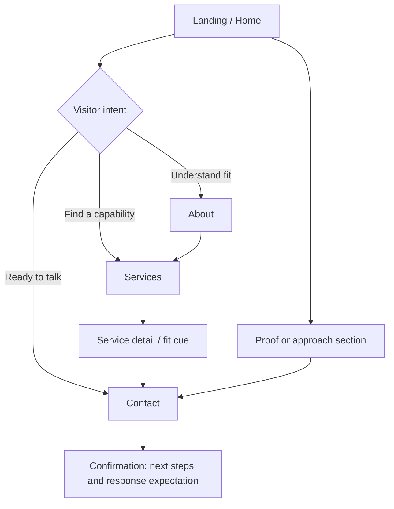

# Northstar Studio Website Wireframing

> **A low-to-mid fidelity wireframe specification for a four-page digital consultancy website: Home, About, Services, and Contact.**

## 1. Project snapshot

| Item | Specification |
|---|---|
| **Role** | UX designer and product strategist; IA, content hierarchy, responsive planning, interaction states, and handoff guidance |
| **Scope** | Four pages, navigation, conversion paths, responsive behavior, accessibility, and reusable UI patterns |
| **Platform** | Responsive marketing website for desktop, tablet, and mobile browsers |
| **Timeline** | 10 working days: discovery and IA (2), page wireframes (4), responsive/system pass (2), validation and documentation (2) |
| **Deliverables** | Annotated wireframe plan, user flow, page specifications, tokens, component/state inventory, canvas organization, validation plan, and case study narrative |
| **Fidelity intent** | Structure, hierarchy, content behavior, and interaction logic are defined before visual polish |

## 2. Problem, opportunity, and assumptions

### Problem
Northstar Studio helps growing organizations make better product and service decisions. Its website must establish credibility, explain an unfamiliar consulting offer, and turn interest into a well-formed conversation. Without structure, visitors may miss proof, see an undifferentiated service list, or abandon contact because they do not know what to share.

### Opportunity
Use the site as a guided qualification tool: point of view on Home, proof and principles on About, outcome-led packages on Services, and a low-friction Contact flow. The path should move visitors from **“Is this relevant?”** to **“I know what to ask for and how to start.”**

### Working assumptions
- The primary conversion is a qualified discovery inquiry, not an immediate purchase.
- Northstar can supply approved client work, testimonials, or representative outcomes later.
- Visitors scan headings, proof, and outcomes; some know a discipline while others only know the business problem.
- Content uses progressive disclosure, with concise summaries before detail.
- One shared navigation/footer is sufficient; no account, blog, calculator, or gated resource center is in scope.

## 3. Goals and success metrics

### Product goals
1. Explain Northstar’s value proposition in one screen and one sentence.
2. Help a visitor self-identify the right service within two minutes.
3. Make credibility scannable through specific evidence, not decorative claims.
4. Collect enough context in Contact to make an initial conversation productive.
5. Establish a responsive, accessible structure that can later accept a visual design layer.

### Success metrics (targets for validation, not measured outcomes)

| Goal | Metric | Initial target |
|---|---|---:|
| Clarity | Unmoderated users can describe what Northstar does after viewing Home | 4 of 5 users accurately paraphrase the offer |
| Findability | Users locate a relevant service from Home or Services | 90% completion within 60 seconds |
| Confidence | Users identify at least one credible proof signal | 4 of 5 can recall a proof point |
| Conversion | Qualified inquiry completion from Contact | 35% completion among users who start the form |
| Form quality | Submitted inquiries contain challenge, goal, and timing | 80% include all three fields |
| Accessibility | Keyboard and screen-reader review of core paths | No critical or serious issues; WCAG 2.2 AA intent |

## 4. Target users and jobs-to-be-done

| User | Context and need | Job to be done |
|---|---|---|
| **Growth-stage founder** | Has a promising product but scattered priorities and limited internal design capacity | “Help me decide what to solve first and show me a practical route to impact.” |
| **Product or marketing lead** | Needs an external partner for research, strategy, or a redesign and must build an internal case | “Help me compare the right engagement and give me evidence I can share with stakeholders.” |
| **Operations or transformation lead** | Sees friction across a service or process and needs alignment across teams | “Help us turn a complex problem into a clear, testable plan.” |

Secondary visitors may be referral partners or prospective team members; the primary experience optimizes for a client with an active challenge.

## 5. Current-state and research observations

This is a planning exercise, so these are **hypotheses to validate** from the brief and common consultancy-site behavior:

- Labels such as “strategy” or “innovation” need a business outcome and example deliverable.
- Buyers seek early evidence: recognizable challenge, approach, result, or client voice.
- A generic “Contact us” creates anxiety when next steps and response time are unknown.
- Long agency pages bury the distinction between capability, process, and engagement format; mobile needs short blocks and a compact action.

Confirm these assumptions through five stakeholder interviews, a lightweight competitor scan, and five task-based usability sessions.

## 6. Design decisions and rationale

1. **Outcome-led service cards.** Lead with problem, approach, outputs, and “good fit when…” so visitors can self-select.
2. **One primary CTA.** Repeat “Start a conversation”; secondary “Explore services” links support learning without competing.
3. **Proof before process.** Home gets a proof band; Services/About get deeper case-study patterns before the form ask.
4. **Short pages and cross-links.** Each page has one job and next step, preserving the Home–Services–Contact loop.
5. **Context-aware form.** Challenge, outcome, timing, and contact details qualify the inquiry; budget stays optional.
6. **Content-first responsive behavior.** Cards stack, comparisons become accordions, and collapsed navigation retains the CTA.
7. **Low-to-mid fidelity language.** Neutral surfaces, blocks, labels, and annotations expose hierarchy before brand polish.

## 7. Information architecture and user flow

### Primary navigation
**Home · About · Services · Contact** with a persistent “Start a conversation” action. The footer repeats the four links, contact email, social/legal placeholders, and a short positioning statement.

The happy path is **Home → Services → Contact**; the trust path is **Home → About → Services → Contact**. Every page offers a sensible Contact exit.

## 8. Detailed screen and layout breakdown

### Home — orient and motivate
1. **Header:** wordmark, four links, outlined/solid primary CTA; mobile menu exposes the same order.
2. **Hero:** eyebrow “Digital consultancy for complex decisions,” outcome-led headline, two-line explanation, primary and secondary CTAs, and a restrained abstract “north star” visual placeholder.
3. **Proof strip:** three approved proof placeholders (engagements, sectors, or outcomes) plus optional client-logo row; never imply invented results.
4. **Challenge selector:** three cards—Find direction, Improve an experience, Align a team—with a short description and Services link.
5. **Approach:** three numbered steps: Frame, Focus, Move. Include one sentence on collaboration and a link to About.
6. **Selected proof and CTA:** case-study teaser with challenge/intervention/outcome fields, followed by “Tell us what is stuck; we will reply within two business days.”

### About — build trust and distinctiveness
1. **Intro:** point of view, concise studio description, and a human image/illustration placeholder with accessible caption guidance.
2. **Principles:** three to five principles expressed as behaviors, such as “Make the decision visible,” not generic values.
3. **How we work:** a horizontal desktop sequence that becomes stacked mobile steps; each step names client involvement and decision output.
4. **Team or network:** role cards with expertise, not inflated biographies; include an optional partner model explanation.
5. **Proof and CTA:** testimonial, credentials, or sectors with source labels and permission status, then links to Services and Contact.

### Services — help visitors choose
1. **Page intro:** “Choose the intervention that matches the decision in front of you,” with a compact filter-like set of challenge tags (non-functional in this plan).
2. **Service modules:**
   - **Direction:** research synthesis, opportunity framing, and a prioritized roadmap.
   - **Experience:** journey mapping, prototype testing, and service/product improvement.
   - **Alignment:** workshops, operating-model clarity, and decision facilitation.
3. Each module repeats: problem, outcomes, activities, outputs, engagement shape, and “good fit when…” statement.
4. **Engagement comparison:** Sprint, Focused engagement, and Embedded partner become stacked cards/accordion on mobile; avoid unvalidated price claims.
5. **FAQ and CTA:** six questions cover timing, involvement, remote work, procurement, and next steps; “Describe your challenge” links to Contact with a visible service context label.

### Contact — reduce uncertainty and qualify gently
1. **Intro panel:** reassurance about who should contact Northstar, expected response time, and what happens next.
2. **Form:** required fields: name, work email, organization, challenge, desired outcome, and timing. Optional: service of interest, budget range, referral source. Use plain-language helper text and an explicit privacy note.
3. **Alternative route:** contact email and a short “not ready?” link back to Services; do not create a dead end.
4. **Confirmation/error:** show next steps and About/Services links; preserve entered data and identify the first fix on error.

## 9. Design system specification

| Category | Tokens / rules |
|---|---|
| **Typography** | Inter or equivalent system sans; display 48/56 desktop, 36/44 tablet, 32/38 mobile; H2 32/40, H3 24/32, body 16/24, small 14/20; sentence case, maximum line length 65 characters |
| **Color tokens** | `ink-900 #17202A` primary text; `ink-600 #53606D` secondary text; `surface-0 #FFFFFF`; `surface-50 #F5F7F8`; `line-200 #D8DEE3`; `north-700 #164A63` link/interactive; `north-100 #DCECF1` soft fill; `signal-500 #C56B3D` accent used sparingly; `success-700 #246B4A`; `danger-700 #A33A3A` |
| **Spacing** | 4px base unit; use 8, 12, 16, 24, 32, 48, 64, 80, 96px. Section padding: 80 desktop, 56 tablet, 40 mobile. |
| **Grid** | 12 columns desktop with 24px gutters and 80px outer margins; 8 columns tablet with 20px gutters and 40px margins; 4 columns mobile with 16px gutters and 20px margins. Max content width 1200px. |
| **Components** | Header, button, text link, proof stat, service card, step item, testimonial, FAQ accordion, form field, select, checkbox, alert, breadcrumb/context label, footer. Components expose content and state variants rather than page-specific copies. |
| **States** | Default, hover, focus-visible, pressed, disabled, loading, success, error, empty, and validation message. Focus ring uses a 2px high-contrast outline with 2px offset. |
| **Accessibility** | WCAG 2.2 AA intent; semantic heading order, visible labels, keyboard access, 44px minimum touch target, meaningful link names, alt-text rules, error summary, no color-only meaning, reduced-motion alternative, and contrast checked for every token pairing. |

## 10. Auto-layout and Figma implementation guidelines

Build each frame with vertical auto-layout and spacing tokens; use max-width containers, not manually positioned text. Let text fill width and headings hug height. Nest auto-layout for cards, buttons, form rows, and CTA bands. Use component properties for content/state and variants only where behavior differs. Name layers by role (`Section / Heading`, `Card / Service / Body`), keep annotations in a review layer, pin edge controls with constraints, preserve media ratios, and let cards stack at breakpoints. Never simulate responsiveness with absolute positioning.

## 11. Detailed Figma canvas layout plan

Organize the canvas left-to-right in reading order, with an annotation rail below each row. Coordinates use a 1440px-wide desktop planning canvas; section names are also the intended frame names.

| Order | Named section / frame | Size and position |
|---:|---|---|
| 01 | `00_README / Legend` | 720 × 520 at (0, 0); tokens, symbols, annotation key |
| 02 | `01_FLOW / Primary user flow` | 1200 × 620 at (800, 0); entry, decision points, success path |
| 03 | `02_SYSTEM / Foundations` | 1200 × 900 at (2080, 0); type, color, grid, spacing, accessibility notes |
| 04 | `03_HOME / Desktop 1440` | 1440 × 3900 at (0, 760); full page, 12-column grid |
| 05 | `03_HOME / Tablet 834` | 834 × 3600 at (1520, 760); collapsed navigation and stacked cards |
| 06 | `03_HOME / Mobile 390` | 390 × 4300 at (2480, 760); 4-column grid and sticky CTA note |
| 07 | `04_ABOUT / Desktop 1440` | 1440 × 3200 at (0, 4860) |
| 08 | `04_ABOUT / Mobile 390` | 390 × 3600 at (1520, 4860) |
| 09 | `05_SERVICES / Desktop 1440` | 1440 × 4300 at (0, 8500) |
| 10 | `05_SERVICES / Mobile 390` | 390 × 4700 at (1520, 8500) |
| 11 | `06_CONTACT / Desktop 1440` | 1440 × 2200 at (0, 13300) |
| 12 | `06_CONTACT / Mobile 390` | 390 × 2600 at (1520, 13300) |
| 13 | `07_STATES / Interaction states` | 1200 × 1100 at (2480, 8500); form, FAQ, nav, and confirmation states |
| 14 | `08_REVIEW / Open questions` | 1200 × 720 at (2480, 9700); assumptions, content owners, validation decisions |

Within each page frame, order sections top-to-bottom: header, hero/intro, evidence, primary content, secondary content, CTA, footer. Use matching x-origins across desktop frames so reviewers can compare page structure quickly.

## 12. Validation and testing plan

1. **Content comprehension (5 remote participants):** show Home for 10 seconds; ask what Northstar does, who it serves, and the next action. Revise hero language if fewer than four agree.
2. **Tree and flow check (5 participants):** find a service for a stated challenge and reach Contact; record first click, time, and wrong turns.
3. **Form usability (5 participants):** complete Contact with a realistic scenario; test field comprehension, optionality, error recovery, privacy, and confirmation.
4. **Accessibility review:** keyboard traversal, focus order, 200% zoom, screen-reader landmarks/headings, contrast, reduced motion, and touch targets.
5. **Stakeholder critique:** verify service claims, proof permissions, response SLA, and fit with the sales conversation.

**Decision rule:** fix issues blocking understanding, navigation, or completion before typography or imagery. Log evidence, severity, change, and owner.

## 13. Outcomes and expected impact

No live performance data is available because this is a wireframing specification. **Target/expected impact:** a clearer service narrative, fewer ambiguous navigation choices, better-qualified inquiries, and a reusable structure that allows brand visual design to proceed without rethinking the information architecture. The success metrics in Section 3 define how those expectations should be tested after launch.

## 14. Ready-to-publish GitHub README section

### Problem
Prospective Northstar Studio clients need to understand an abstract consultancy offer quickly, trust the team’s approach, and know what to include in a first inquiry. A generic brochure structure risks hiding outcomes, proof, and next steps.

### Solution
Designed a responsive four-page wireframe plan that guides visitors from relevance to confidence to action. Home clarifies the point of view, About makes the studio’s principles tangible, Services maps common challenges to concrete engagement outcomes, and Contact turns interest into a contextual, low-friction inquiry.

### User flow
**Home → choose a challenge → review service fit → describe the challenge → confirmation with next steps.** Visitors who need more trust can take the alternate route **Home → About → Services → Contact**.

### Key highlights
- Outcome-led service architecture for expert and non-expert visitors.
- Reusable page and component patterns across desktop, tablet, and mobile.
- Contextual contact form designed to improve inquiry quality without over-qualifying.
- Explicit interaction, error, focus, and responsive states before visual polish.
- Accessibility and validation requirements integrated into the specification.

## 15. Portfolio presentation checklist

- [ ] Lead with the one-sentence problem and the four-page outcome.
- [ ] Show the primary flow before showing individual screens.
- [ ] Include one annotated Home view, one Services module, and the Contact success/error states.
- [ ] Explain at least three decisions with evidence or a stated hypothesis.
- [ ] Distinguish wireframe intent from final visual design; do not imply a shipped product.
- [ ] Include responsive comparisons and the grid/token rationale.
- [ ] State clearly that impact metrics are targets until validated with users or live analytics.
- [ ] Credit research assumptions, content dependencies, and open questions.
- [ ] End with the next iteration: test copy, validate service taxonomy, then apply the visual identity.
