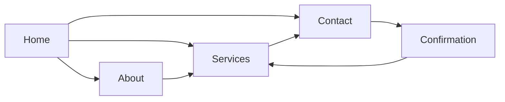

# Task 3 Layout Specification — Northstar Studio Website

## Wireframe intent

These layouts are low-to-mid fidelity planning artifacts. They resolve hierarchy, content placement, navigation, page flow, and responsive behavior before visual branding or imagery is applied.

## Global navigation schema

Primary navigation: `Home · About · Services · Contact`. The header includes the wordmark and persistent `Start a conversation` CTA. Footer repeats the four links, contact email, short positioning statement, and legal placeholders.

The intended happy path is `Home → Services → Contact`; the trust path is `Home → About → Services → Contact`. Every page provides an obvious route to Contact without trapping the visitor.

## Content placement rules

- Desktop content sits in a 1200px max-width container with a 12-column grid.
- Tablet uses 8 columns; mobile uses 4 columns with 20px page padding.
- Use a consistent 80px desktop / 56px tablet / 40px mobile section rhythm.
- Every page has one primary job and one primary CTA.
- Use short content blocks with visible labels; avoid paragraph walls.
- Place proof immediately after the first meaningful claim, not only at the bottom.

## Home wireframe

1. **Header:** logo left, four nav links, primary CTA right.
2. **Hero:** eyebrow, outcome-led headline, short supporting paragraph, primary `Start a conversation` CTA, secondary `Explore services`, abstract visual placeholder.
3. **Proof strip:** three verified proof placeholders or outcome stats.
4. **Challenge selector:** three cards: `Find direction`, `Improve an experience`, `Align a team`.
5. **Approach:** three numbered steps: Frame, Focus, Move.
6. **Selected proof:** case-study teaser with challenge, intervention, outcome, and link.
7. **Closing CTA:** response-time reassurance and Contact link.
8. **Footer.**

Mobile behavior: stack hero content, place CTA pair vertically, convert challenge cards into a swipe-safe vertical list, and retain a compact sticky CTA only if it does not obscure content.

## About wireframe

1. Intro and point of view.
2. Principles expressed as observable behaviors.
3. How-we-work sequence with client involvement and decision output.
4. Team or network role cards.
5. Proof, credentials, and permissioned testimonial.
6. Links to Services and Contact.

The page should answer: who are you, how do you work, and why should a client trust the process?

## Services wireframe

1. Intro: choose the intervention that matches the decision in front of you.
2. Challenge tags or filter-like cues.
3. Three service modules: Direction, Experience, Alignment.
4. Each module: problem, outcomes, activities, outputs, engagement shape, good-fit cue.
5. Engagement comparison: Sprint, Focused engagement, Embedded partner.
6. FAQ addressing timing, involvement, remote work, procurement, and next steps.
7. Contextual CTA to Contact.

On mobile, service modules become accordions or stacked cards; comparison content becomes a readable sequence rather than a compressed table.

## Contact wireframe

1. Intro panel with who should contact, response expectation, and what happens next.
2. Form fields: name, work email, organization, challenge, desired outcome, timing; optional service, budget, referral source.
3. Helper text and privacy note.
4. Alternative email route and link back to Services.
5. Confirmation state with next steps and preserved context.
6. Error state with summary and first invalid field focus.

## Wireframe annotation conventions

- Blue outline: interactive element.
- Gray fill: structural content block.
- Dashed border: media or content placeholder.
- Numbered note: interaction or responsive behavior.
- Red annotation: open content, legal, or validation dependency.

## Figma organization

Use pages: `00_Cover`, `01_Research`, `02_Flow`, `03_Wireframes`, `04_Responsive`, `05_Annotations`. Name frames `Home / Desktop`, `Home / Mobile`, `About / Desktop`, `About / Mobile`, `Services / Desktop`, `Services / Mobile`, `Contact / Desktop`, and `Contact / Mobile`. Keep annotations outside the core frame and align desktop page frames to one shared x-origin.
