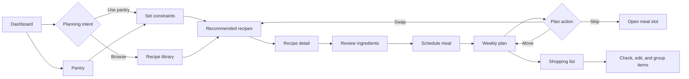

# PantryPal — UX Case Study Analysis

> **A UX evaluation of a fictional meal-planning app focused on reducing friction and turning pantry ingredients into confident weekly meals.**

## Project snapshot

| Field | Detail |
|---|---|
| **Role** | UX researcher, interaction designer, product strategist |
| **Scope** | Heuristic review, task-flow analysis, IA, responsive screens, design system, and validation plan |
| **Platform** | Responsive web app; desktop-first planning with mobile support |
| **Timeline** | 3-week concept study: discovery (3 days), evaluation (4 days), solution definition (6 days), validation planning and case-study packaging (2 days) |
| **Deliverables** | Findings, opportunity map, redesigned flow, page/layout specs, component/accessibility guidance, canvas plan, testing protocol |

## Problem and opportunity

PantryPal helps people organize ingredients, discover recipes, and build a weekly meal plan. The fictional experience exposes features as separate destinations: **Pantry**, **Recipes**, **Plan**, and **Shopping List**. A user can accomplish each task in isolation, but the product does not make the relationship between them obvious.

The primary problem is not a lack of functionality; it is a lack of **decision support**. A user who opens PantryPal with “I have chickpeas, spinach, and 30 minutes” must infer where to begin, remember what is already at home, compare recipes, place meals on days, and manually reconcile missing ingredients. Each transition creates cognitive load and opportunities for duplicated work.

The opportunity is to make PantryPal feel like a guided planning assistant rather than a set of inventory screens. The redesigned experience should connect pantry context, constraints, recipe confidence, meal-plan placement, and shopping-list cleanup in one understandable loop.

### Assumptions

- The core audience plans at least three dinners per week and wants to reduce food waste or grocery overspending.
- Pantry data is imperfect: users will not inventory every spice or remember exact quantities.
- Most users begin with a constraint (available ingredient, time, diet, household size, or budget), not a recipe name.
- A weekly plan is useful only when it remains editable and produces a practical shopping list.
- Findings are synthesized from a heuristic review and scenario walkthroughs, not claimed as live-user research.

## Goals and success metrics

### Product and UX goals

1. **Orient quickly:** show users what to do next from the home dashboard.
2. **Make relevance visible:** explain why a recipe matches pantry items and constraints.
3. **Reduce handoffs:** move from recipe discovery to a scheduled meal without losing context.
4. **Keep plans forgiving:** support substitutions, skips, leftovers, and partial pantry information.
5. **Create a trustworthy list:** distinguish items already available from items to buy.

### Success metrics for a future prototype or release

| Outcome | Metric | Target |
|---|---|---:|
| Faster first decision | Median time from dashboard to first recipe saved | ≤ 90 seconds |
| Better flow completion | Scenario completion: “plan 3 dinners from pantry” | ≥ 80% unassisted |
| Less navigation friction | Average screens/route changes per completed scenario | Reduce by 30% from baseline walkthrough |
| Better recommendation confidence | Users correctly explain why the top recipe is recommended | ≥ 4 of 5 test participants |
| More useful plans | Planned meals that produce a reviewed shopping list | ≥ 85% |
| Perceived ease | Post-task ease rating (1–7) | ≥ 5.5 |
| Accessibility quality | Critical WCAG 2.2 AA issues in audit | 0 open before handoff |

These are **proposed evaluation targets**, not measured results.

## Target users and jobs-to-be-done

### Primary user: the time-constrained household planner

A working adult plans weekday dinners for one to four people, often between meetings or while commuting. They know what is in the kitchen approximately, have limited patience for data entry, and want a plan that is realistic rather than aspirational.

### Jobs-to-be-done

- **Use ingredients before they expire:** find relevant meal ideas and waste less food.
- **Plan a busy week:** set time, diet, and serving constraints once and get realistic recommendations.
- **Assess a recipe:** see what is at home and missing before committing.
- **Handle change:** swap or skip a meal without breaking the week.
- **Shop efficiently:** use one deduplicated list grouped by store area.

## Current-state evaluation and observations

These observations come from a heuristic review and end-to-end walkthrough of the fictional product.

| Observation | UX consequence | Severity |
|---|---|---:|
| The dashboard emphasizes “Browse recipes” but hides the pantry-to-plan starting point | Users begin broad browsing instead of using their strongest context | High |
| Pantry items require exact quantity and category entry before recommendations improve | Setup feels like bookkeeping; users abandon or enter unreliable data | High |
| Recipe cards show cuisine and rating but not pantry match, prep time, or missing items at a glance | Users open several details pages to compare feasibility | High |
| “Add to plan” opens a separate calendar step with no suggested day | The flow loses the recipe’s context and increases decision effort | Medium |
| Shopping List mixes pantry items and buy items in one undifferentiated checklist | Users cannot trust what remains to purchase | High |
| Meal cards lack a clear swap/skip affordance | Users treat the plan as fragile and avoid editing it | Medium |

**Priority bottlenecks:** starting ambiguity, excessive pantry precision, hidden recommendation rationale, disconnected planning/shopping, and low recoverability when a meal changes.

## Design decisions and rationale

### 1. Lead with a “Plan from what you have” action
The dashboard opens with pantry highlights, upcoming plan status, and a prominent action. This matches the constraint-led job while preserving browse for inspiration.

### 2. Treat pantry data as confidence levels
Users can mark an item **Have**, **Low**, or **Not sure**; quantity is optional. Recommendations use the signal without forcing inventory completion, making uncertainty explicit.

### 3. Add a recommendation explanation layer
Cards display “Uses 3 pantry items,” active time, and missing count. A compact “Why this?” panel explains the match without exposing a black-box ranking formula.

### 4. Use a guided three-step planning drawer
Instead of routing users away, a drawer supports **Discover → Review → Schedule**. The recipe, constraints, and progress remain visible; a suggested day uses prep time and plan gaps.

### 5. Make change safe and local
Every meal exposes Swap, Move, and Skip. Swap preserves day, servings, and constraints; Skip creates a recoverable “needs a meal” slot.

### 6. Separate “at home” from “to buy” everywhere
Recipe detail and shopping list share a two-part ingredient model. Deduplication, quantities, and category grouping remain visible and editable.

## Information architecture and user flow

**Primary happy path:** Dashboard → Plan from pantry → constraints → recommendations → recipe detail → review ingredients → schedule → weekly plan → shopping list.

**Recovery paths:** incomplete pantry data leads to “Add an item” or “Continue with what we know”; a rejected recipe returns to recommendations with filters retained; a skipped meal creates a recoverable slot.

## Detailed screen and layout breakdown

### 1. Dashboard
- **Header:** PantryPal wordmark, current week selector, search, profile/settings.
- **Hero task card:** “What can you make this week?” with pantry count, expiring-item hint, and primary CTA **Plan from what I have**.
- **Plan preview:** seven-day strip with filled, open, and skipped states; each meal has a visible Swap action.
- **Recommendation rail:** three cards with pantry match, active time, missing count, items to use soon, and list progress.

### 2. Constraint sheet
Use a desktop modal and mobile bottom sheet with time chips (15/30/45+ minutes), serving stepper, diet, equipment, and pantry-confidence toggle. Persist constraints on return to results.

### 3. Recommendations
- Sticky summary bar showing constraints and **Edit**.
- Sort options: Best pantry match, Fastest, Lowest missing cost.
- Card anatomy: image, title, cuisine tag, active/total time, servings, pantry match meter, missing ingredients, and **Review** button.
- Empty state offers one-constraint broadening, pantry-item addition, or unfiltered browse.

### 4. Recipe detail
- **Above the fold:** title, image, rating, time, servings, dietary labels, and primary **Schedule meal** CTA.
- **Evidence panel:** “Why this recipe” with pantry matches, items to buy, and substitutions.
- **Ingredients:** segmented At home / To buy lists with quantity controls.
- **Method and actions:** numbered steps with time markers; sticky Schedule, Save, Share, and More bar.

### 5. Weekly plan
Desktop uses a seven-column calendar; mobile stacks days. Cards include title, time, servings, Swap, Move, and Skip. A top summary shows planned dinners, open slots, and estimated cost when available.

### 6. Shopping list
- Header with week selector, progress, and **Add item**.
- Tabs: All, To buy, At home; “At home” is informational and can be moved to To buy.
- Sections grouped by store area: Produce, Dairy, Pantry, Frozen, Other.
- Duplicate ingredients are merged with an editable quantity and source-meal label.
- Checked state remains visually persistent in the specification.

## Design system specification

### Foundations
- **Typography:** Inter, with system sans-serif fallback. Display 32/40 semibold; page title 24/32 semibold; section title 18/24 semibold; body 16/24 regular; helper 14/20; compact label 12/16 medium. Avoid all-caps for long labels.
- **Color tokens:** Ink `#1F2933`; muted ink `#52606D`; canvas `#F7F8F6`; surface `#FFFFFF`; primary green `#256D4A`; primary tint `#E3F2E9`; accent amber `#C8792A`; success `#2F855A`; warning `#B7791F`; danger `#B83245`; border `#D9E2EC`; focus `#1D4ED8`.
- **Spacing:** 4px base unit; use 4, 8, 12, 16, 24, 32, 40, and 48px. Component internals generally use 12–16px; page sections use 32–48px.
- **Grid:** desktop 12 columns, max content width 1200px, 24px gutters; tablet 8 columns, 20px gutters; mobile 4 columns, 16px page padding, 16px gutters where applicable.
- **Shape and elevation:** 8px control radius, 12px cards, 16px sheets; one subtle shadow for floating surfaces, no shadow for standard cards unless interactive.

### Components and states
Buttons have primary, secondary, tertiary, and destructive variants. Inputs cover default, hover, focus, filled, error, disabled, and read-only. Chips cover unselected, selected, removable, and unavailable. Recipe and meal cards cover default, saved/loading, open-slot, skipped, and conflict states; checkboxes cover unchecked, checked, indeterminate, disabled, and focus-visible.

### Accessibility requirements
Target **WCAG 2.2 AA**: 4.5:1 text contrast (3:1 for large text/non-text boundaries), visible keyboard focus, logical headings, labeled controls, and 44×44px touch targets. Dialogs trap and return focus. Use meaningful image alt text, empty alt for decoration, 200% zoom, reduced motion, announcements for saved/swapped meals, and a keyboard alternative to drag-and-drop.

## Auto-layout and Figma implementation guidelines

Use Auto Layout for reusable components and content-bearing frames. Set labels to **Hug contents** and descriptions to **Fill container**; use min/max widths rather than fixed text widths. Use 12px metadata gaps and 16px control padding. Make the card content stack fill height so varying titles do not misalign the CTA.

Create properties for variant, state, icon visibility, pantry-match level, and meal status. Use nested icon, tag, and ingredient-row instances; define styles and variables from the token list. Build 1440, 1024, 768, and 390px variants. Test long titles before approving fixed heights; use constraints for headers and overlays for sheets, drawers, and toasts.

## Detailed Figma canvas layout

This is a **canvas specification**, not a claim that a Figma file exists

| Section order | Named section | Frame sizes and coordinates |
|---:|---|---|
| 01 | `00_Cover_and_Readme` | 1440×900 at x=0, y=0; title, premise, scope, legend |
| 02 | `01_Foundations` | 1440×1200 at x=0, y=980; tokens, type scale, grid, accessibility notes |
| 03 | `02_Components` | 1440×1800 at x=0, y=2260; buttons, fields, chips, cards, meal states, tables |
| 04 | `03_Current_State` | 1440×1000 at x=0, y=4200; annotated current dashboard, recipe, plan, list |
| 05 | `04_Flow_Map` | 1600×900 at x=0, y=5260; IA, happy path, recovery paths |
| 06 | `05_Dashboard_and_Constraints` | 2880×1200 at x=0, y=6220; desktop frames at 0/1480 and mobile at 0/900 |
| 07 | `06_Recommendations_and_Detail` | 2880×1400 at x=0, y=7520; results, detail, drawer states |
| 08 | `07_Weekly_Plan_and_List` | 2880×1400 at x=0, y=9080; plan, swap, skip, shopping list |
| 09 | `08_Prototype_and_Testing` | 1440×1000 at x=0, y=10640; clickable path map, test tasks, notes |
| 10 | `09_Handoff` | 1440×800 at x=0, y=11700; behavior notes, open questions, acceptance checklist |

Order each product section **desktop default → states → tablet → mobile → annotations**; use 80px section gaps, 40px frame gaps, and an upper-right legend.

## Validation and testing plan

Run two rounds. **Round 1, formative:** five participants matching the primary profile plan three dinners from chickpeas, spinach, rice, eggs, and one expiring item. Observe first action, recommendation comprehension, constraint use, scheduling, and list review; follow with a short trust interview.

**Round 2, comparative:** eight participants split between current-state walkthrough and redesigned prototype. Measure completion, time to first saved recipe, route changes, errors, rationale recall, and ease. Include one keyboard-only participant and an expert screen-reader check.

Include recovery tasks: swap a broken Tuesday meal without changing the week, and show what remains to buy when rice is already available. Log blocker/high/medium/low severity. Advance when no blocker remains, high-severity issues have a resolution, and metrics improve directionally.

## Outcomes and impact

No live user or production data is claimed. Expected impact is **lower planning effort**, greater recommendation confidence, and more actionable shopping lists. If validated, likely gains are a shorter pantry-to-scheduled-meal path, fewer Recipe/Plan/List backtracks, and safer recovery.

## Ready-to-publish GitHub README section

### Problem
PantryPal’s features work independently, forcing users to manually connect pantry inventory, discovery, scheduling, and shopping. The result is decision fatigue, repeated navigation, and low confidence that a plan reflects what is at home.

### Solution
I redesigned the journey around **Plan from what I have**. Confidence levels reduce data entry; cards explain pantry match and missing items; a Discover → Review → Schedule drawer preserves context; and plan/list share one editable ingredient model.

### User flow
`Dashboard → Set constraints → Recommendations → Recipe detail → Review ingredients → Schedule meal → Weekly plan → Shopping list`

Recovery supports swap, move, skip, broadened constraints, and incomplete pantry data.

### Key highlights
- Constraint-led dashboard that answers “what should I do next?”
- Explainable recipe cards with pantry match, active time, and missing-item count
- Forgiving weekly plan with safe Swap, Move, and Skip actions
- Deduplicated shopping list separated into **At home** and **To buy**
- Responsive, tokenized, accessibility-first design specification
- Validation plan with measurable targets and limitations

## Portfolio presentation checklist

- [ ] State clearly that PantryPal is fictional and outcomes are targets, not measured production results.
- [ ] Show the problem before the polished solution and include the observation table.
- [ ] Include one annotated current-state screen and one end-to-end redesigned flow.
- [ ] Explain at least three decisions with evidence or a specific heuristic rationale.
- [ ] Show responsive behavior, empty states, loading/error states, and recovery actions.
- [ ] Demonstrate the ingredient model across recipe detail, plan, and shopping list.
- [ ] Include accessibility decisions, keyboard behavior, and contrast verification.
- [ ] Present the Figma canvas map and component strategy without implying a file exists.
- [ ] Label metrics and impact statements as proposed, expected, or to be validated.
- [ ] End with learnings, open questions, and the next validation step.
